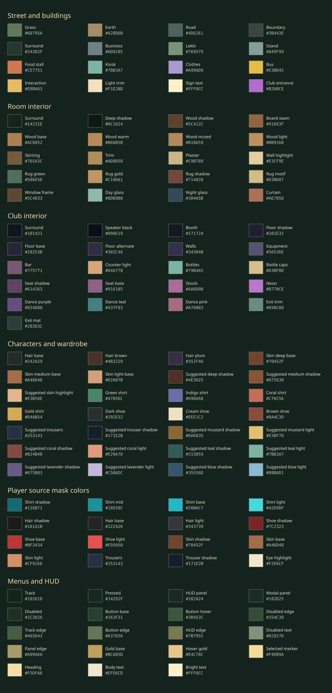

# PH NIGHT — Aseprite redraw workbook

Start with one standing player pose, then one complete character, then the props. Work at the size players will actually see. Keep the current artwork as a tracing reference and save your editable drawings separately before replacing game assets.

## Files included with this guide

- [Palette preview](art/palettes/palette-preview.svg): named swatches with hex values.
- [Street and buildings](art/palettes/ph-night-street.gpl).
- [Room interior](art/palettes/ph-night-room.gpl).
- [Club interior](art/palettes/ph-night-club.gpl).
- [Characters and wardrobe](art/palettes/ph-night-characters.gpl).
- [Player source mask colors](art/palettes/ph-night-player-masks.gpl).
- [Menus and HUD](art/palettes/ph-night-ui.gpl).
- [Palette data](art/palettes/palettes.json): names, hex values, and source notes.

The environment and UI palettes collect selected colors already used by the game's scripts. They are practical starting palettes, not an exhaustive extraction from the generated PNGs. The character palette combines actual runtime wardrobe colors with suggested shading ramps. The source mask palette is a technical palette for the current player recoloring system; it serves a different purpose from the visible wardrobe palette.



## 1. Find your tracing references

Paths below are relative to the project folder.

| Reference | Where to find it | What to redraw |
| --- | --- | --- |
| Player | `assets/art/characters/player-v1.png` | Body proportions, clothing, front/back/profile poses |
| Tunde | `assets/art/characters/tunde-v1.png` | Mustard work shirt and delivery satchel |
| Amara | `assets/art/characters/amara-v1.png` | Coral blouse, apron and headwrap |
| Sade | `assets/art/characters/sade-v1.png` | Teal outfit and short natural hair |
| Bisi | `assets/art/characters/bisi-v1.png` | Lavender shirt and rounded hair puff |
| Femi | `assets/art/characters/femi-v1.png` | Blue work shirt and boots |
| Props | `assets/art/lagos-props-v1.png` | Buildings, stalls, furniture, bus and objects |
| Room architecture | `scripts/world/RoomInterior.gd` and an in-game screenshot | Walls, floorboards, windows, rug and threshold |
| Club architecture | `scripts/world/ClubInterior.gd` and an in-game screenshot | Bar, dance floor, seats, booth and exit |
| Courtyard, shop and cafe | `scripts/world/NeighborhoodArt.gd` and in-game screenshots | Raised beds, benches, noticeboard, shelves, counter, crates and outdoor tables |
| Street tiles | `scripts/world/District.gd` | Ground, road and collision-wall appearance |
| Controls and menus | `UI/NeedIcon.gd`, `UI/ControlGlyph.gd`, `scripts/ui/PixelMenuTheme.gd` | Icons, frames and button appearance |

The room, club, courtyard, shop interior, cafe tables, terrain and many interface elements are drawn in code. They do **not** have a matching source PNG to open. Use a game screenshot to study their appearance, then draw replacement assets separately. Wiring those assets into the game will require a code/scene change. Club supervisor Nneka, guest Kemi and DJ Dele now have distinct code-native idle sprites in `scripts/characters/VenueCast.gd`; use their silhouettes and matching dialogue portraits as redraw references. See the [after-audit screenshots](ui-audit/after/screenshots/).

Use the recorded character and prop pack as your starting references. `playerSprite.png` is a legacy image with an unverified source; it is not the current player artwork. See [asset records](ASSET_LICENSES.md) and record your own redraws there when integrated.

## 2. Set up an Aseprite master

1. Create an **RGBA** sprite with a transparent background. For a character pose, use **32 × 48 pixels**.
2. Load one of the supplied `.gpl` palettes using Aseprite's palette-loading controls. GPL here means GIMP Palette format; the extension is not a license declaration. See the [official palette guide](https://www.aseprite.org/docs/tutorial/color-bar-tutorial/).
3. Put a copy of the reference on a layer named `Reference`. Reduce its opacity and lock it.
4. Draw on layers above it: `Body`, `Clothing`, `Hair`, `Shoes`, and optionally `Details`. Keep the reference layer out of exports.
5. Use a 1-pixel pencil with hard edges. Resize references with nearest-neighbor sampling. Avoid softened edges and almost-transparent fringe pixels.
6. Save your working file as `.aseprite`; export a separate transparent PNG for the game. The editable format preserves layers and animation data; see [Aseprite files](https://www.aseprite.org/docs/files).

Suggested storage, to create when you start drawing:

```text
assets/art/source/characters/player-v2.aseprite
assets/art/source/props/lagos-props-v2.aseprite
assets/art/source/interiors/room-v2.aseprite
assets/art/source/interiors/club-v2.aseprite
assets/art/characters/player-v2.png
assets/art/lagos-props-v2.png
```

Keep `v1` intact while experimenting. Use 100% zoom to judge readability, then zoom in to edit. Check the art against both light flooring and the dark club background.

## 3. Trace at the right scale

The generated source sheets are much larger than the final characters. Tracing every source pixel would preserve detail that disappears in-game.

For a clean redraw, fit the character into a 32 × 48 frame. Aim for a centered body no wider than about 30 pixels, with the soles on row **45** (zero-based) and transparent space below. Keep one shared head position and foot baseline across all poses. The existing adapter fits the shared visible bounds into at most **30 × 44** pixels, bottom-aligned at coordinate **y = 46**.

When preparing tracing references from the large sheets, use the **same crop rectangle and scale for every pose**. Cropping each pose tightly on its own causes head sizes and foot positions to jump. Treat the original as a silhouette and costume reference; correct uneven eyes, changing proportions, stray pixels and repeated leading legs as you redraw.

The characters are shown at 2× scale in the world. A single authored pixel therefore becomes roughly two world pixels before camera/window scaling. The current player also has a slight code-driven idle breath, so begin with a stable single-frame idle.

## 4. Character sheet layout and animation

The current source format uses **four columns × three rows**:

| Direction row | Column 1 | Column 2 | Column 3 | Column 4 |
| --- | --- | --- | --- | --- |
| Down / toward camera | Standing | Left-foot contact | Standing / passing | Right-foot contact |
| Up / away from camera | Standing | Left-foot contact | Standing / passing | Right-foot contact |
| Right / profile | Standing | First contact | Standing / passing | Opposite contact |

The game mirrors the profile row to face left. Avoid designs that need independent left-facing lettering or asymmetric equipment unless the loader is updated.

For a new native-size export, **128 × 144 pixels** holds twelve 32 × 48 frames in this layout. Use equal cells, no padding, no trimmed frames, and no packed/rotated frames. Keep transparency. Aseprite's [sprite-sheet documentation](https://www.aseprite.org/docs/sprite-sheet/) explains importing and exporting sheets. A 128 × 144 sheet is the recommended *new authoring format*, not the dimensions of the current generated files.

Current character source PNGs are 1182 × 1330, split by proportional boundaries in `CharacterArt.gd`. The loader crops, rescales and then applies pose repairs. **A newly drawn sheet is not yet a direct pixel-for-pixel replacement**, even if its grid matches:

- `CharacterArt.cells()` normalizes the shared bounds into 32 × 48 frames.
- `CharacterArt.player_cells()` rebuilds the player's front/back opposite contact poses by mirroring and reuses the standing poses.
- `CharacterArt.npc_cells()` aligns each head and copies a selected head over the four frames. Its per-NPC head heights depend on the current art.

When integrating finished hand-drawn sheets, add a native-sheet loading path that reads the 32 × 48 cells without those generated-art repairs. Keep the existing path available for unfinished characters. Otherwise, authored head motion and contact poses may be overwritten. Exporting a new PNG alone does not perform this integration.

Animation names expected by the game are `idle_down`, `idle_up`, `idle_side`, `walk_down`, `walk_up`, and `walk_side`. Idle uses one frame; walking uses four. NPC walking plays at 7 FPS. Player walking is driven by distance: one cycle per 144 world pixels, shared by all clothing layers. Use roughly 140 ms per frame for an Aseprite preview; that is a preview convenience, not a change to game speed.

Check each walk cycle for alternating feet, counter-swinging arms, a stable head, consistent eye placement, and soles that stay on the ground. Start with one front-facing cycle before drawing the other directions.

## 5. Player colors and wardrobe compatibility

NPC colors can be chosen freely. The **current player loader identifies clothing parts by color and position**, then recolors those pixels at runtime. Simply painting the source shirt green can break wardrobe switching.

| Source part | Current detection rule | Practical tracing choice |
| --- | --- | --- |
| Shirt | Hue between 0.38 and 0.58; saturation above 0.45 | Saturated cyan/teal mask ramp |
| Hair | Final frame y < 22; value < 0.36; saturation < 0.38 | Dark, nearly neutral hair ramp |
| Shoes | Final frame y > 34; red > 1.6×green and > 1.4×blue | Red mask ramp |
| Skin tint | Remaining body pixels: hue between 0.025 and 0.12; saturation > 0.4 | Warm brown skin ramp |

Hue, saturation and value use Godot's normalized 0–1 ranges. These rules are applied **after** frame extraction and resizing. A dark face outline can accidentally become hair; a cyan accessory can become shirt. Keep the source mask colors distinct and check every wardrobe choice in the game.

Use `ph-night-player-masks.gpl` if preserving the current loader. Those are suggested mask-safe ramps, not sampled source colors. Visible shirts use the actual runtime bases: green `#47856C`, indigo `#696DA8`, coral `#C76C56`, and gold `#D4AB54`. Mask brightness affects the final shaded result.

For finished art, the cleaner integration is to export **separate aligned body, shirt, hair and shoe sheets**, using identical 32 × 48 grids, and change `LayeredCharacter.gd` to read them directly. The game does not currently load these exported layers automatically. Keep your Aseprite layers separate now so this later change is straightforward.

## 6. Props and environment

The existing prop atlas is **1448 × 1086**, with twelve **362 × 362** cells:

| Row | Column 1 | Column 2 | Column 3 | Column 4 |
| --- | --- | --- | --- | --- |
| 1 | Room facade | Food stall | Provisions kiosk | Clothing stall |
| 2 | Parcel | Stock shelves | Danfo bus | Bed |
| 3 | Housing desk | Chair | Planter | Generator |

For an easier native-size redraw, a suggested atlas is **256 × 192**, with **64 × 64** cells in exactly that order. Retain transparent margins and a common bottom alignment. `PixelArt.gd` reads the atlas size dynamically, but its preload path must be changed for a `v2` filename. The current width-based placement also needs visual review; some world widths are not integer multiples of 64.

Typical current display widths are 192 world pixels for building/stall props, 128 for stock/clothes/bus, 64 for parcels, and 96 by default. Room furniture overrides some widths. Changing an image does not change its interaction range or collision.

Terrain uses a **32 × 32** grid. Suggested new floor and wall tiles should use that size. For the room, use the warm wood/plaster palette; for the club, use dark purples and restrained teal/pink accents. Keep the bar and exit distinct from decoration. Choose a consistent upper-left light direction as an art convention for new drawings; the current code art is a reference, not a strict lighting model.

Use 3–4 shades per material: shadow, base, light, and an optional highlight. Make floors quieter than characters. Put the strongest contrast on faces, interactable objects and exits. Test night scenes in the game before making every outdoor sprite darker; the game already applies a night tint and lights.

## 7. Redraw order and handoff checklist

- [ ] Player standing down pose: choose proportions and palette first.
- [ ] Player down walk, then up and profile; test wardrobe layers.
- [ ] One NPC as a full animation test, then the remaining four.
- [ ] Bed, door, desk, chair and plant for the home base.
- [ ] Food/kiosk/clothes stalls, parcel, stock shelves, bus and generator.
- [ ] Street tiles, room tiles, club furniture and dance floor.
- [ ] UI icons and splash/menu art after the world style is settled.

For every finished asset, keep the `.aseprite` master, transparent PNG, palette, dimensions, grid layout, anchor notes and version name. Review at 1× and in-game size. Hide tracing layers before export, keep all frames the same size, and remove faint alpha fringes. Record whether it is a redraw from a project reference or an original design.

Integration checkpoints: `CharacterArt.gd` for character loading; `LayeredCharacter.gd` for wardrobe layers; `PixelArt.gd` for props; `District.gd`, `RoomInterior.gd` and `ClubInterior.gd` for environments. Preserve gameplay collisions unless you deliberately redesign the walkable space.

After integration, use the existing character, walking, NPC-eye, room, club and HUD test scenes, then inspect the game visually. Some visual tests encode details of the present artwork and should be reviewed when a deliberate redesign changes those details. Update them to check the new art's intended behavior.

This workbook and its palettes are preparation materials. They do not replace the current game art or change its loader.
